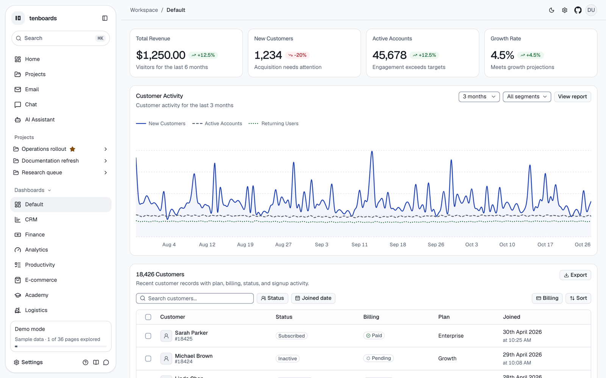
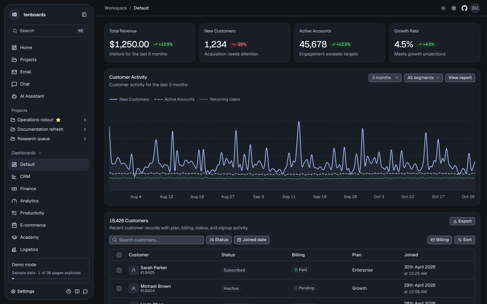
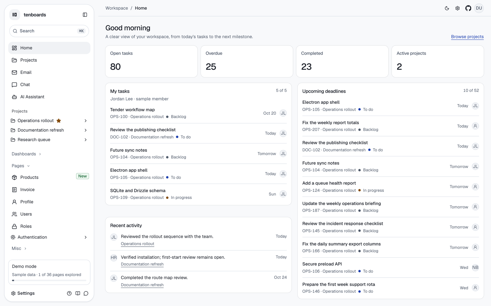
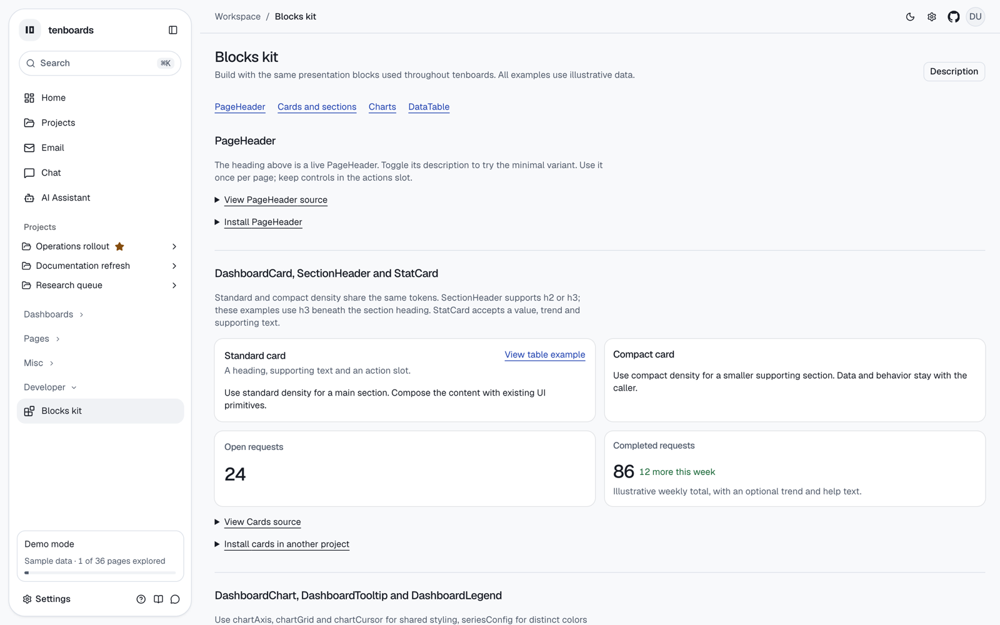
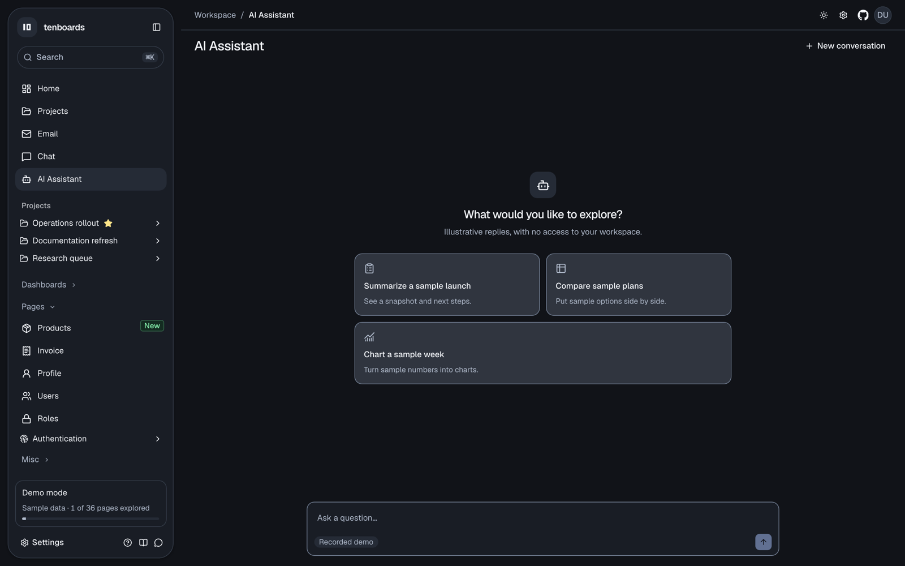

# tenboards

An agent-first, MIT-licensed dashboard template built with TanStack Start, React 19, TypeScript, Tailwind CSS v4 and shadcn/ui on Base UI.

Point Codex or Claude Code at a clone and ask for a dashboard or page. Agents get an adopter guide, Agent Skills, page generators and public blocks, so the on-system path is the shortest one. `npm run check` and `npm run verify:page` fail on off-system UI.

**[Project homepage](https://tenboards.mohanadgh.workers.dev/)** · **[Live demo](https://tenboards.mohanadgh.workers.dev/dashboard/default)** · [Blocks kit](https://tenboards.mohanadgh.workers.dev/dashboard/kit) · [llms.txt](https://tenboards.mohanadgh.workers.dev/llms.txt) · [Changelog](CHANGELOG.md)



| | |
| --- | --- |
|  |  |
|  |  |

## Build with an agent

Start a fresh Codex or Claude Code session in your clone and ask, for example, “add a Sales dashboard with revenue KPIs and a top-products table” or “add a Vendors page listing vendors”.

- **[AGENTS.md](AGENTS.md)** gives the stack, file map, build loop and invariants. Claude Code imports it through `CLAUDE.md`.
- **Agent Skills:** [tenboards-build-ui](.agents/skills/tenboards-build-ui/SKILL.md) covers generators, blocks and page verification. [tenboards-connect-data](.agents/skills/tenboards-connect-data/SKILL.md) covers typed reads, migrations, seeds and demo/database parity. Codex discovers `.agents/skills/`; Claude Code discovers the symlinks in `.claude/skills/`.
- **Generators:** `npm run new:dashboard sales` or `npm run new:page vendors` scaffold a route, navigation entry, guarded loader, typed reads and fixtures.
- **Blocks:** import `PageHeader`, `DashboardCard`, `StatCard`, `DataTable`, `DashboardChart` and friends from `@/components/blocks`. Every block has a live example at `/dashboard/kit`.
- **Guardrails:** `npm run check` fails on raw colors, arbitrary sizes and look-alike cards. `npm run verify:page -- /dashboard/<slug>` captures light/dark × desktop/mobile and fails on axe violations and console or hydration errors. All 37 catalog routes pass.
- **Outside this repo:** agents can read `/llms.txt` and `/llms-full.txt`. Other shadcn projects can install blocks with `npx shadcn add https://YOUR-HOST/r/stat-card.json`. Installing a block also applies the tenboards theme globally, so review the CSS changes.

Generated database reads are illustrative stubs. Use the data skill and `npm run data:parity` before claiming a real database integration.

## Quick start

Use Node 22+ and npm. No environment variables or database are required.

```sh
git clone https://github.com/moeghashim/tenboards.git
cd tenboards
OPENUI_TELEMETRY_DISABLED=1 DO_NOT_TRACK=1 npm install
npm run dev
```

Open <http://localhost:3000/> for the homepage or <http://localhost:3000/dashboard/default> for the demo. Keep OpenUI install telemetry disabled as shown.

| Command | Purpose |
| --- | --- |
| `npm run dev` | Development server on port 3000 |
| `npm run build` / `npm run preview` | Production build; preview the compiled Worker locally |
| `npm run check` | Biome, design guardrails, skills, registry and llms freshness |
| `npm run typecheck` | TypeScript |
| `npm run verify:page -- <route>` / `-- --all` | Four-state screenshots, axe and runtime checks |
| `npm run new:dashboard <slug>` / `new:page <slug>` | Scaffold a page |
| `npm run registry:build` / `npm run llms:build` | Regenerate registry JSON and LLM docs |
| `npm run db:generate` / `db:migrate` / `db:seed` / `data:parity` | Optional Postgres workflow |

See the [full command list](docs/reference.md#commands).

## What's included

- **Ten dashboards:** Default, CRM, Finance, Analytics, Productivity, E-commerce, Academy, Logistics, Infrastructure and Patient Monitoring.
- **Workspace:** Home, Projects (Overview, Board, List, Timeline and Files), an AI Assistant, Mail, Chat, Invoice, Products, Users, Roles, Profile, auth pages and system states.
- **Design system:** compact tokens in [DESIGN.md](DESIGN.md), light/dark themes, presets, a floating sidebar, a ⌘K palette and layout settings.
- **Optional integrations:** [Postgres data layer](docs/data-layer.md) with Drizzle, [Better Auth](docs/auth.md), [AI Assistant providers](docs/assistant.md) and [Cloudflare Workers deployment](docs/deploy.md).

The live site is a zero-config demo with sample data and auth off. Adopters connect and verify their own database by following the [deployment quick path](docs/deploy.md#quick-path).

## Replace the project homepage

`/` is a public, server-rendered project homepage in both demo and auth modes.
The live demo starts at `/dashboard/default`; `/dashboard` and `/dashboard/`
continue redirecting there. Auth fallbacks, the sidebar brand and recovery links
also keep that destination.

To start your clone directly in the app, replace
`src/routes/(external)/index.tsx` with the redirect below, then delete
`src/routes/(external)/-components/homepage.tsx`,
`src/routes/(external)/-components/quick-start.tsx` and `public/homepage/`:

```tsx
import { createFileRoute, redirect } from "@tanstack/react-router";
import { APP_LANDING_ROUTE } from "@/navigation/landing";

export const Route = createFileRoute("/(external)/")({
  beforeLoad: () => {
    throw redirect({ href: APP_LANDING_ROUTE, replace: true });
  },
});
```

Set the `/` capture entry's `ready` text in `src/navigation/route-catalog.ts`
back to `"Total Revenue"`. The homepage-specific assertions in
`scripts/homepage-check.ts`, `scripts/screenshot-system.ts`,
`scripts/project-redirect-check.ts`, `scripts/blocks-kit-check.ts` and
`scripts/generators-browser.ts` should then expect the redirect again; classify
`/` with the protected app entries in `scripts/auth-protection-check.ts`.
Keep `src/components/theme-switcher.tsx`: the dashboard uses it too.
Generators, blocks and Agent Skills do not depend on the homepage.

## Documentation

- [Reference](docs/reference.md): commands, previews, visual QA, data layer, auth and per-milestone notes
- [Design guardrails](docs/design-guardrails.md) · [Data layer](docs/data-layer.md) · [Auth](docs/auth.md) · [Assistant](docs/assistant.md) · [Deploy](docs/deploy.md)
- [Changelog](CHANGELOG.md) and [releases](https://github.com/moeghashim/tenboards/releases). v0.1–v0.9.1 are released; v0.9.0 is the agent-first release and v0.9.1 adds the project homepage.

## Contributing

Upstream contributions follow [dev/MAINTAINERS.md](dev/MAINTAINERS.md) and [CONTRIBUTING.md](CONTRIBUTING.md). PLAN.md and its Decisions log govern the project.

## Provenance and license

MIT. Imported from [arhamkhnz/tanstack-shadcn-admin-dashboard](https://github.com/arhamkhnz/tanstack-shadcn-admin-dashboard) (Studio Admin), revision [`81e5ef1`](https://github.com/arhamkhnz/tanstack-shadcn-admin-dashboard/commit/81e5ef1391b68c176154faba0c9ac7b0023ecbaf). Copyright © 2026 Mohammed Arham Khan. The original MIT notice is preserved in [LICENSE](LICENSE), alongside the tenboards copyright. Upstream contributor guidance is archived at [docs/upstream-AGENTS.md](docs/upstream-AGENTS.md).
